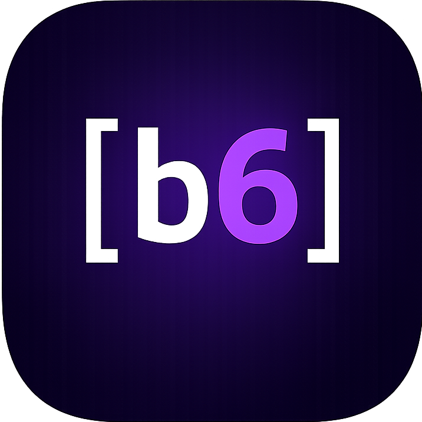
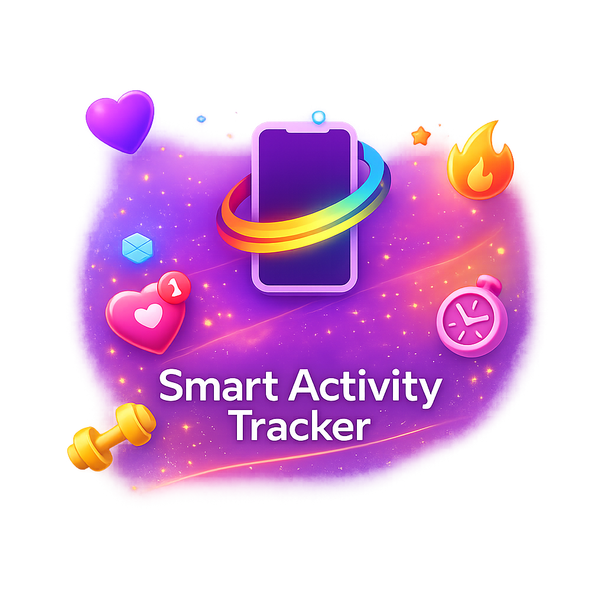

<table width="100%">
<tr>
<td width="60%" valign="middle" align="left">

<h2 align="left">About me</h2>

  Привет! Я — backend-разработчик, работающий с Java, Kotlin и Go.
  Фокусируюсь на backend-системах, REST/gRPC API, базах данных,
  event-driven архитектуре и распределённых системах.

  Интересуюсь fintech, high-load системами, наблюдаемостью, чистой архитектурой
  и production разработкой.

  
  

  
  &nbsp;&nbsp;
  
  &nbsp;&nbsp;
  

</td>

<td width="40%" valign="middle" align="center">

</td>
</tr>
</table>

<h2 align="center">Technologies && Processes</h2>

  <b>Backend</b> 
  
   
  <b>Databases & Storage</b> 
  
   
  <b>Messaging & API</b> 
  
   
  <b>DevOps & Observability</b> 
  
   
  <b>Tools & Workflow</b> 
  

  
  
  
  
  

---

<h2 align="center">Statistics</h2>

  

<table align="center">
<tr>
<td align="center" width="50%">
  
</td>
<td align="center" width="50%">
  
</td>
</tr>
</table>

 

<table align="center">
<tr>
<td align="center" width="50%">
  
</td>
<td align="center" width="60%">
  
</td>
</tr>
</table>

---

<h2 align="center">Projects</h2>

<!-- ==================== JAVA / KOTLIN ==================== -->

<h3 align="center">Java / Kotlin Backend</h3>

<table align="center" width="100%">

<tr>

<td width="50%" valign="top" align="center">

 

<h3>Notification Subscription Platform</h3>

  Событийная платформа уведомлений с подписками, асинхронной обработкой событий
  и доставкой через несколько каналов.

  
  
  
  
  
  
  
  

  

</td>

<td width="50%" valign="top" align="center">

 

<h3>Smart Activity Tracker</h3>

  Backend-сервис для сбора пользовательских событий,
  хранения активности и расчёта базовых продуктовых метрик.

  
  
  
  
  
  
  

  

</td>

</tr>

<tr>
<td colspan="2"> </td>
</tr>

<tr>

<td width="50%" valign="top" align="center">

<h3>FlashSale Tickets</h3>

  Распределённая система бронирования билетов для сценариев резкого всплеска нагрузки
  с резервированием мест, асинхронными событиями и отдельными сервисами каталога,
  заказов, платежей и уведомлений.

  
  
  
  
  
  
  
  

  

</td>

<td width="50%" valign="top" align="center">

<h3>AuctionFlow</h3>

  Платформа аукционов в реальном времени с event-driven архитектурой,
  анти-снайпингом, транзакционным Outbox, идемпотентной обработкой ставок
  и отдельной read-моделью для быстрых запросов.

  
  
  
  
  
  
  
  

  

</td>

</tr>

</table>

 

<!-- ==================== GO ==================== -->

<h3 align="center">Go / Infrastructure Engineering</h3>

<table align="center" width="100%">

<tr>

<td width="50%" valign="top" align="center">

<h3>Distributed Job Processing Platform</h3>

  Распределённая платформа выполнения фоновых задач с планировщиком,
  PostgreSQL-очередью, gRPC-воркерами, арендами задач, heartbeat,
  повторными попытками и dead-letter queue.

  
  
  
  
  
  
  
  

  

</td>

<td width="50%" valign="top" align="center">

<h3>High-performance API Gateway</h3>

  Высокопроизводительный reverse proxy с маршрутизацией,
  балансировкой нагрузки, rate limiting, circuit breaker,
  health checks, retries и горячим обновлением конфигурации.

  
  
  
  
  
  
  

  

</td>

</tr>

</table>

 

<!-- Добавить после реализации:
WalStream
FlagForge
-->

<!-- ==================== CROSS STACK ==================== -->

<h3 align="center">Team & Cross-stack Projects</h3>

<table align="center" width="100%">

<tr>

<td width="50%" valign="top" align="center">

 

<h3>Trade360Lab</h3>

  Платформа для исследования торговых стратегий,
  подготовки рыночных данных, запуска сценариев и сравнения результатов.

  
  
  
  
  
  
  

  

  

</td>

<td width="50%" valign="top" align="center">

 

<h3>Porta Trading System</h3>

  Распределённая торговая система с Kafka-событиями,
  управлением состоянием портфеля и пользовательским аналитическим интерфейсом.

  
  
  
  
  
  
  

  

</td>

</tr>

<tr>
<td colspan="2"> </td>
</tr>

<tr>

<td width="50%" valign="top" align="center">

 

<h3>PingTower</h3>

  Система мониторинга сайтов и сервисов с проверками доступности,
  алертами, историей измерений и статистикой надёжности.

  
  
  
  
  
  
  

  

</td>

<td width="50%" valign="top" align="center">

 

<h3>Visual Circuit Designer</h3>

  Веб-платформа для проектирования, симуляции
  и управления цифровыми логическими схемами.

  
  
  
  
  
  
  

  

</td>

</tr>

</table>

 
